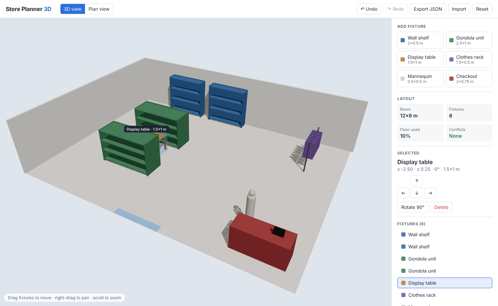

# Store Planner 3D

A small 3D retail layout planner: drag shelves, tables, racks and checkouts around a store floor,
switch between 3D and plan view, and get instant feedback on conflicts.

**Live demo:** https://store-planner-3d.vercel.app/



## Features
- **3D scene** with React Three Fiber — real-world dimensions in metres, shadows, orbit / pan / zoom
- **Drag & drop** on the floor plane with 25 cm grid snapping and room-boundary clamping
- **Rotate, delete, add** from a fixture catalogue; new fixtures auto-placed in the nearest free spot
- **Conflict detection** — overlapping fixtures turn red; floor-usage stats update live
- **3D ⇄ plan view** with animated camera transition
- **Undo / redo** (a whole drag is one step)
- **Import / export** versioned JSON with runtime schema validation
- **Accessible**: fully operable by keyboard, `aria-live` announcements, semantic landmarks, visible focus

## Tech
| Area | Choice |
|------|--------|
| UI | React 18, TypeScript (strict) |
| 3D | three.js, @react-three/fiber, @react-three/drei |
| State | Zustand (with undo/redo history) |
| Tests | Vitest — domain logic + store |
| Build / CI | Vite, GitHub Actions → typecheck, test, build, deploy to GitHub Pages |

## Architecture
```
src/
  lib/layout.ts         Pure domain logic (snap, clamp, collisions, validation) — no React/three
  data/catalog.ts       Fixture catalogue (would come from a CMS / API in production)
  store/                Zustand store: actions, undo/redo, import/export
  components/
    Scene.tsx           Canvas, lighting, room, camera rig
    FixtureMesh.tsx     Per-fixture 3D model + drag interaction
    Sidebar.tsx         Catalogue, stats, inspector, accessible fixture list
    Toolbar.tsx         View toggle, history, import/export
docs/SPEC.md            Specification with acceptance criteria (spec-driven development)
```
Domain logic is deliberately separated from rendering so it can be tested in isolation and reused
on a backend (e.g. validating layouts behind a REST/OpenAPI endpoint).

## Keyboard
| Key | Action |
|-----|--------|
| ← ↑ ↓ → | Move selected fixture 25 cm |
| R | Rotate 90° |
| Delete | Remove |
| Esc | Deselect |
| Ctrl+Z / Ctrl+Shift+Z | Undo / redo |

## Run
```bash
npm install
npm run dev        # http://localhost:5173
npm test
npm run build
```

## Next steps
See [docs/SPEC.md](docs/SPEC.md#out-of-scope--next): REST persistence with an OpenAPI contract,
CMS-driven catalogue, aisle-clearance rules, loading real store shells (GLTF / APS).
